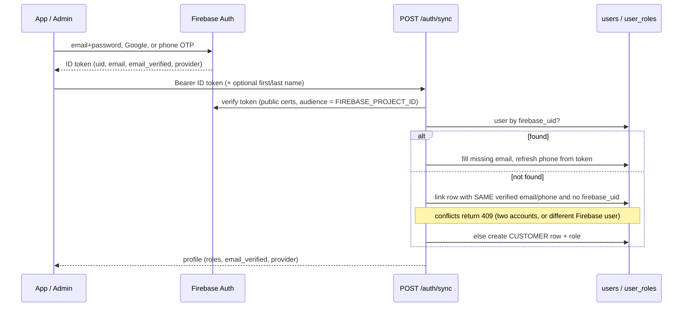

# Data Flow

> **Status:** Verified against source on 2026-10-14. Flows describe the *code paths*; behaviour under real Razorpay/Firebase traffic was not exercised (see "Verification" at the end).
> **Evidence:** [`services/order.py`](../../backend/app/services/order.py), [`checkout_session.py`](../../backend/app/services/checkout_session.py), [`payment.py`](../../backend/app/services/payment.py), [`refund.py`](../../backend/app/services/refund.py), [`inventory_reservation.py`](../../backend/app/services/inventory_reservation.py), [`fulfillment.py`](../../backend/app/services/fulfillment.py), [`auth.py`](../../backend/app/services/auth.py), [`realtime.py`](../../backend/app/core/realtime.py).

## 1. Sign-in and account creation



Rules: identity comes only from the verified token, never the body; an unverified email never links to an existing row; verified email and phone pointing at two different rows → 409; a lost race on first sign-in is resolved by re-reading the row (`IntegrityError` path); inactive users are refused. Source: `AuthService.sync_user`, `_link_existing`, `_create_customer`. Pre-Firebase accounts use `POST /auth/legacy-migrate` once ([AUTHENTICATION](../05-domains/AUTHENTICATION.md)).

## 2. Cash-on-Delivery checkout

1. `POST /cart/checkout` (`OrderService.checkout`) — locks the user's latest cart row; if it is already `CHECKED_OUT` returns the existing order (`created=False`, the retry-safe path). Otherwise, in **one transaction**: lock variants in id order, validate status/price/currency/address ownership, compute line totals (`ROUND_HALF_UP`), evaluate the promotion (re-checking its usage limit under a row lock), compute the delivery fee with `calculate_delivery_fee` from the real cart and address, create `orders` (`PENDING`) + `order_items` + `order_addresses`, **FIFO-allocate and reserve stock** (`create_reservation_for_order`, 30-minute expiry), record the promotion redemption, mark the cart `CHECKED_OUT`, commit, then notify.
2. `POST /payments {order_id, payment_method: "COD"}` (`PaymentService.create_payment` → `_confirm_cod`) — locks Order then Payment, commits the reservation (`ACTIVE → COMMITTED`; if it already expired the request rolls back with 409), sets the order `CONFIRMED`; payment stays `PENDING`.
3. Fulfilment moves forward (§5). At **delivery confirmation** the COD payment moves `PENDING → PAID` in the same transaction ([`_collect_cod_payment`](../../backend/app/services/fulfillment.py)).

Failure behaviour: insufficient stock aborts the whole checkout with nothing written; an expired reservation blocks COD confirmation; a duplicate `POST /payments` returns the existing payment without any new side effect.

## 3. Online checkout (pay-first)

```mermaid
sequenceDiagram
  participant App
  participant API as /payments/online/*
  participant RZ as Razorpay
  participant DB
  App->>API: POST /payments/online/start {address_id, promo_code}
  API->>DB: price the cart (read-only quote), check stock is available
  API->>RZ: create order (amount from server)
  API->>DB: checkout_sessions row PENDING (re-used if basket unchanged)
  API-->>App: key_id, gateway_order_id, amount
  App->>RZ: Razorpay Checkout (WebView) - customer pays
  alt app callback arrives
    App->>API: POST /payments/online/{id}/confirm (order_id, payment_id, signature)
    API->>API: HMAC verify (key secret)
  else callback lost
    RZ->>API: webhook payment.captured / order.paid (signed)
    App->>API: or POST /payments/online/{id}/verify
  end
  API->>RZ: query order status (authoritative, not the client)
  API->>DB: lock session; OrderService.checkout(expected_total=session.amount)
  alt order created
    API->>DB: Payment (PROCESSING) + transaction, verify_payment -> PAID, order CONFIRMED, session COMPLETED
  else cannot place (stock, price changed, address deleted)
    API->>RZ: refund_payment
    API->>DB: session REFUNDED or REFUND_FAILED (logged, needs a human)
  end
```

Idempotency: re-calling `confirm`/`verify`/webhook on a `COMPLETED` session returns the same order; the webhook is deduplicated by `payment_webhook_events (gateway_name, event_id)`; the session is row-locked during finalisation. **Known defect (PAY-001):** if the user's latest cart was already ordered another way (e.g. COD), `OrderService.checkout` returns that existing order and `_finalize` attaches the captured payment to it without refunding; reproduced and recorded in [DEFECT_LOG](../testing/DEFECT_LOG.md); guarded by a strict `xfail` test; **not fixed**.

## 4. Payment webhooks and reconciliation

`POST /payments/webhooks/razorpay` (public route, raw body): verify `X-Razorpay-Signature` (HMAC-SHA256 with the webhook secret; rejects with 401 on mismatch) → parse (ignored event types are acknowledged) → insert the dedup row (`flush`, unique violation ⇒ duplicate ⇒ acknowledged and ignored) → refund events go to `RefundService.apply_webhook_update`; payment events resolve the transaction by gateway transaction id, else by gateway order id, else try to complete a checkout session → lock Order then Payment → check amount and currency against the stored payment (mismatch ⇒ event marked `FAILED`, `PAYMENT_RECONCILIATION` logged, no state change) → apply the transition through `payment_state` (illegal/late transitions are logged, never raised) → confirm the order if paid (requires committing the reservation; if that fails `PAYMENT_RESERVATION_MISMATCH` is logged and the order is **not** auto-confirmed) → commit once → send realtime/push events after the commit.

Unresolved by design: money captured for a payment/session the system cannot match is only logged (`PAYMENT_WEBHOOK_UNKNOWN_REFERENCE`); there is no reconciliation job.

## 5. Fulfilment and delivery

`Fulfillment` rows move `PENDING → PICKING → PACKED → READY_FOR_DELIVERY` (warehouse roles, `POST /fulfillments/{id}/status`), then `ASSIGNED` (`/assign`, requires a delivery partner), `OUT_FOR_DELIVERY` and `DELIVERED` (`/out-for-delivery`, `/deliver`; assigned partner or ADMIN). `confirm_delivery` locks Order → Fulfillment → reservation → every allocated lot (id order), then in **one transaction** decreases `quantity` and `reserved_quantity` per lot (stock movement type `DISPATCH`), sets the fulfilment `DELIVERED`, the order `COMPLETED`, and collects COD cash. If any lot cannot support its allocation the whole transaction aborts. The state machine permits no skip-ahead, no reverse, and no failed-delivery branch.

## 6. Cancellation and refund

`POST /orders/{id}/cancel` (customer, own order) or `POST /orders/admin/{id}/cancel` (ADMIN): lock the order first; legal from `PENDING` or `CONFIRMED` only (already `CANCELLED` is an idempotent no-op); in **one transaction**: set cancellation fields, release the reservation (`ACTIVE` or `COMMITTED` → `RELEASED`; physical stock untouched), reverse the promotion redemption, and **create a `PENDING_APPROVAL` refund iff the payment is an online one that reached `PAID`**; admins' cancellations are audited. Money moves only when an ADMIN approves and processes the refund: `approve` → `process` (creates a `REFUND` payment transaction with a fresh idempotency key, **commits before the gateway call**, calls Razorpay) → `REFUNDED`/`FAILED` immediately, or stays `PROCESSING` until the `refund.processed`/`refund.failed` webhook or the admin's `sync` resolves it. A gateway timeout leaves the refund `PROCESSING` (outcome unknown), never `FAILED`.

## 7. Reservation expiry

Every 120 s the sweep loop opens its own session and expires up to 500 `ACTIVE` reservations past `expires_at` per tick, each in its own transaction (releasing lot reservations and marking the still-`PENDING` order `EXPIRED`; a failure on one is rolled back and logged, the rest continue); any read of an overdue reservation also self-corrects it. A payment that succeeds after expiry cannot resurrect the reservation (see §4).

## 8. Real-time and push

After a status transition commits, services call `notify_status_event`. It (a) starts a push notification on a daemon thread for eight customer-meaningful `(resource, status)` pairs and (b) if the event loop is registered, sends an invalidation message to that customer's sockets and to staff sockets. Clients refetch over REST. Failures are logged and swallowed. See [NOTIFICATIONS](../05-domains/NOTIFICATIONS.md).

## Verification

Concurrency, replay, ordering and idempotency of §2–§7 are covered by backend tests that use real threads against PostgreSQL ([TESTING_GUIDE](../07-testing/TESTING_GUIDE.md), [`docs/testing/EXISTING_TEST_INVENTORY.md`](../testing/EXISTING_TEST_INVENTORY.md)); the Razorpay gateway is faked there. **Not verified:** a live Razorpay sandbox end-to-end flow, real Expo push delivery, and the Admin/mobile UIs driving these flows (no frontend tests).
