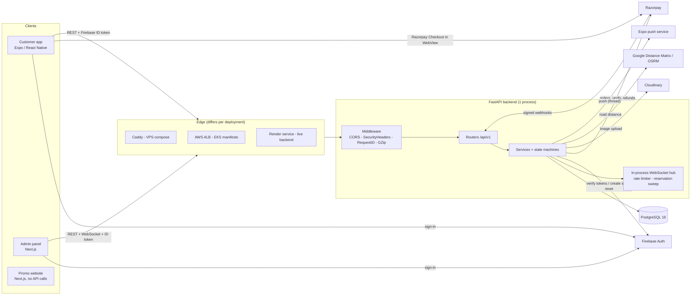
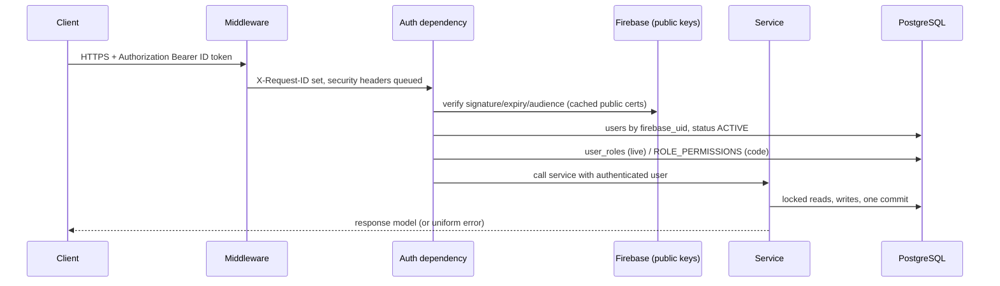

# System Architecture

> **Status:** Verified against source on 2026-10-14. Supersedes nothing: the older overview [`docs/ARCHITECTURE.md`](../ARCHITECTURE.md) is kept and corrected; this document is the evidence-linked version used by the numbered documentation set.
> **Evidence:** [`backend/app/main.py`](../../backend/app/main.py), [`api/v1/router.py`](../../backend/app/api/v1/router.py), [`core/`](../../backend/app/core), [`dependencies/`](../../backend/app/dependencies), the deployment files named in [DEPLOYMENT](../09-deployment-operations/DEPLOYMENT.md).

## 1. Components and responsibilities

| Component | Responsibility | Boundary rule |
|---|---|---|
| Customer app (`mobile/`) | Shopping UI, Firebase sign-in, Razorpay Checkout in a WebView, push registration, OTA updates | Holds no business rules; renders API results; tokens come from the Firebase SDK |
| Admin panel (`Admin/`) | Staff UI, permission-aware navigation, WebSocket alarm | UI permission copy grants nothing; backend re-checks |
| Promo website (`website/`) | Marketing pages | No API usage found |
| Backend (`backend/`) | All rules, pricing, state machines, authorization, integrations | The only writer to PostgreSQL |
| PostgreSQL | Only durable store (also holds idempotency records, audit log, push tokens) | Never exposed publicly in the compose stack |
| Firebase | Identity (passwords, Google, phone OTP, email verification, reset links) | Backend verifies tokens; uses the Admin SDK only for staff creation, password reset, disable/revoke, legacy migration |
| Razorpay | Payment orders, capture, refunds, webhooks | Amount always comes from the server; signatures verified |
| Cloudinary | Image storage for products, categories, ads, home slides | Optional; uploads return 503 `UPLOADS_NOT_CONFIGURED` when unset |
| Google Distance Matrix / OSRM | Road distance for the delivery fee | Failure falls back to straight-line × 1.4 |
| Expo push | Customer notifications | Best effort, background thread |

## 2. Backend layering

`router → dependency (auth/permission/db) → service → model`. Evidence: every file in [`api/v1/`](../../backend/app/api/v1) delegates to a `*Service`.

- **Routers** validate input (Pydantic), declare auth dependencies, call exactly one service method and return a response model. `router.py` mounts them; **mounting order matters** where a literal path (`/orders/admin`, `/payments/refunds`) would otherwise be swallowed by a `/{id}` route registered earlier (comments in `router.py`).
- **Services** own all rules and transactions. Services control their own `commit()`/`rollback()`; the `get_db` dependency only creates and closes a session ([`dependencies/database.py`](../../backend/app/dependencies/database.py)). Services never trust client-computed values.
- **State machines** are pure modules (`order_state`, `payment_state`, `fulfillment_state`, `refund_state`, `reservation_state`, `quote_state`, `bulk_order_state`, `promotion_state`). Illegal transitions raise and map to HTTP 409.
- **Models** are SQLAlchemy 2 declarative classes with `CHECK`/`UNIQUE`/partial-index constraints that back up the rules in the database.
- **Sync stack:** sync SQLAlchemy sessions and sync route functions run on Starlette's threadpool; only the WebSocket route and the webhook route are `async`. The DB pool is 5 + 10 overflow ([PERF-001](../testing/DEFECT_LOG.md)).

## 3. Middleware order

Starlette applies the most recently added middleware outermost. `create_application()` adds GZip, then RequestID, then SecurityHeaders, then CORS (only if `ALLOWED_ORIGINS` is non-empty), so a request passes **CORS → SecurityHeaders → RequestID → GZip → routing**. A `slowapi` limiter is attached to `app.state`; only two routes use it (`/auth/sync` 20/min, `/auth/legacy-migrate` 5/min) and its exception is translated to the uniform error envelope (code `RATE_LIMIT_EXCEEDED`, HTTP 429).

## 4. Request lifecycle (authenticated REST call)

`FirebaseAdminGateway.verify_id_token` additionally performs a per-user revocation/disabled lookup (`auth.get_user`) cached for 60 s; if that lookup fails for any reason the token is **accepted** (the signature was already verified) — a deliberate availability choice recorded in [`firebase.py`](../../backend/app/core/firebase.py). Details: [AUTHENTICATION](../05-domains/AUTHENTICATION.md).

## 5. In-process state (why the backend runs one worker)

| State | Where | Effect with >1 process |
|---|---|---|
| Rate-limit counters | `slowapi` in-memory ([`rate_limit.py`](../../backend/app/core/rate_limit.py)) | Limits multiply per replica; client-IP key can be spoofed via `X-Forwarded-For` when `--forwarded-allow-ips "*"` is used behind a proxy that does not overwrite it (SEC-002) |
| WebSocket registry | `ConnectionManager` ([`realtime.py`](../../backend/app/core/realtime.py)) | Events reach only sockets on the process that handled the change (OPS-003) |
| Reservation sweep | one `asyncio` task per process every 120 s ([`main.py`](../../backend/app/main.py)) | Redundant but safe (OPS-004) |
| Delivery distance cache | `lru_cache` (2048) | Harmless duplication |
| Firebase revocation cache | class-level dict, 60 s TTL | Harmless duplication |

All experiments are in [MULTI_REPLICA_ANALYSIS](../testing/MULTI_REPLICA_ANALYSIS.md); remedies there are proposals, not applied.

## 6. Real-time and notifications

- `notify_status_event(...)` (called by services after a status transition) does two independent things: starts a push notification (background thread) for customer-meaningful transitions, and, if the event loop is registered, sends a small JSON invalidation message `{resource, order_id, status, previous_status, occurred_at}` to the order's customer and to staff sockets. The customer WebSocket path exists in code; the documented consumer is the Admin panel and the mobile `useRealtimeSync` hook.
- Delivery partners are excluded from the staff broadcast. The socket authenticates with the ID token in the query string (`?token=`), which Caddy and the app logger redact.
- REST stays authoritative; clients refetch on a message. Details: [NOTIFICATIONS](../05-domains/NOTIFICATIONS.md).

## 7. Background processing

There is **no queue, scheduler, Redis or Celery**. The only recurring job is the reservation-expiry sweep. Push sends use `threading.Thread`. Payment and refund reconciliation relies on webhooks plus customer/admin-triggered `verify`/`sync` endpoints ([PAYMENTS](../05-domains/PAYMENTS.md)); there is no automatic reconciliation job.

## 8. Failure handling summary

| Failure | Behaviour | Where |
|---|---|---|
| Firebase unreachable | 503 `AUTH_UNAVAILABLE` | `services/auth.py` |
| Service-account JSON invalid/missing file | Same 503 for **every** sign-in (observed in production on 2026-10-14; resolved by removing the variable) | `core/firebase.py` |
| Gateway timeout/connection error | HTTP 502; payment stays `PROCESSING`; webhook or `/verify` resolves | `exceptions/handlers.py`, `payment.py` |
| Database error | Unhandled → generic 500 envelope (stack trace logged, not returned) | `exceptions/handlers.py` |
| Routing API down | Fee falls back to haversine × `DELIVERY_ROAD_FACTOR` | `delivery.py` |
| Push/realtime failure | Logged, never raised into the request | `push.py`, `realtime.py` |

Full error contract: [ERROR_HANDLING](ERROR_HANDLING.md). Request flows: [DATA_FLOW](DATA_FLOW.md). Decisions and their rationale: [ARCHITECTURE_DECISIONS](ARCHITECTURE_DECISIONS.md).

## 9. Client architecture (summary)

- **Mobile:** Expo Router file routes (`mobile/app/`), a single axios client (`src/api/client.ts`) that attaches the Firebase ID token, refreshes once on `TOKEN_EXPIRED`, and routes any other coded 401 (or `EMAIL_NOT_VERIFIED`) on a non-`/auth/` path to an auth-failure handler in the auth store (sign-out, or the verify-email screen); TanStack Query per domain with optimistic cart/wishlist updates; Zustand stores for auth, toasts, payment sheet, wholesale draft; `AppGate` routes between auth, onboarding (first address) and tabs; Razorpay Checkout runs inside a WebView component ([`components/payment/`](../../mobile/src/components/payment)).
- **Admin:** App Router pages under `(admin)/`, typed API clients in `lib/`, `auth-context.tsx` (Firebase sign-in, role gate, token refresh on focus/online/5-minute timer), `realtime-context.tsx` (WebSocket) and `components/NewOrderAlarm.tsx`.
