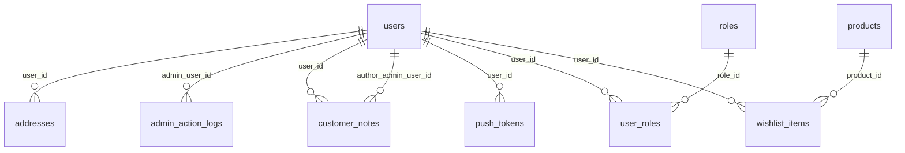
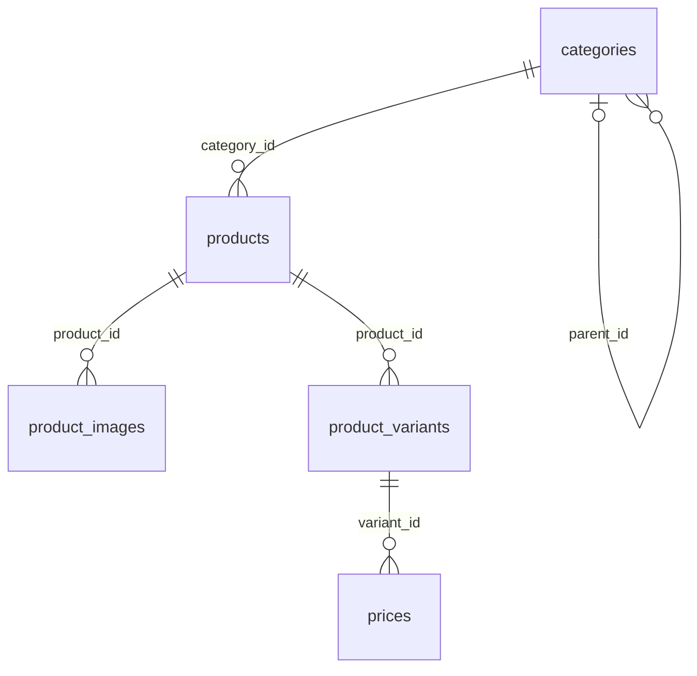
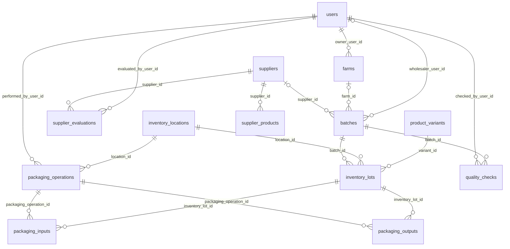
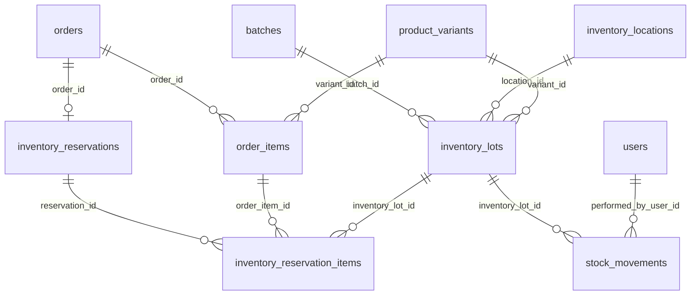
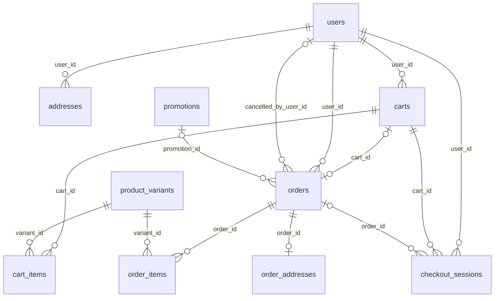
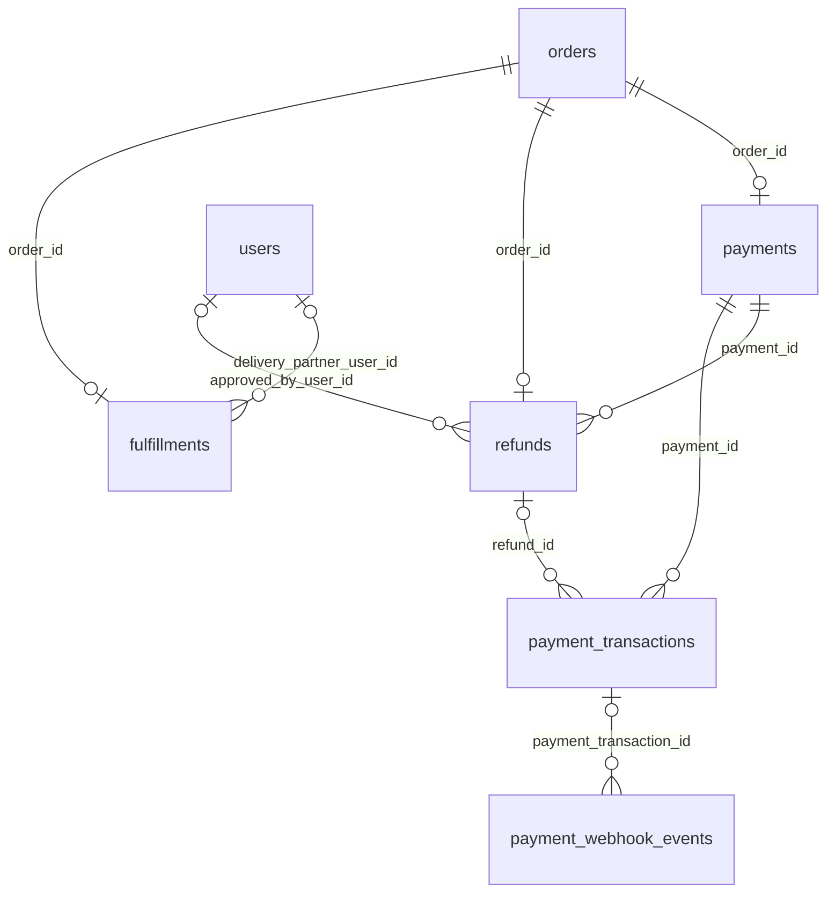
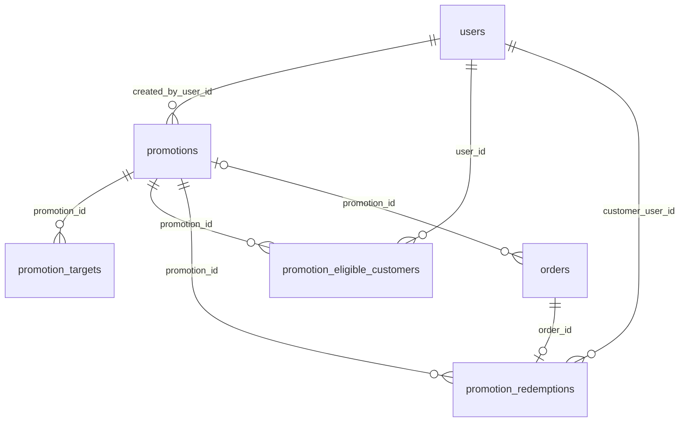
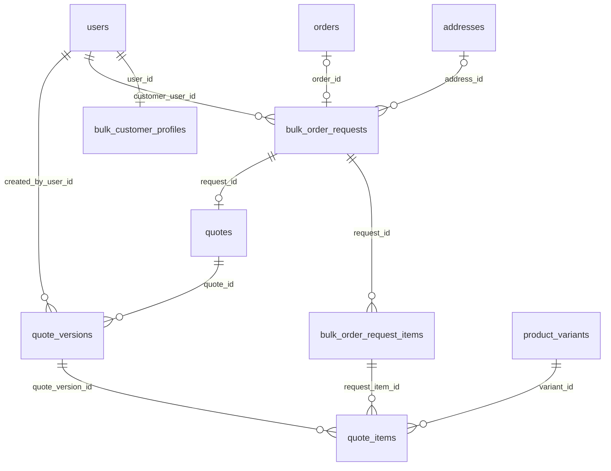

# Entity Relationships

> **Status:** Verified (generated from the SQLAlchemy foreign keys on 2026-10-14; 82 foreign keys, 50 tables). Column-level detail: [DATABASE_SCHEMA.md](DATABASE_SCHEMA.md).
> **Reading the diagrams:** `A ||--o{ B` = each B belongs to exactly one A, an A may have many B; `|o` on the left = the reference is nullable; `o|` on the right = at most one B per A (a **full** unique constraint on the foreign key). Partial unique indexes (one default address per user, one ACTIVE cart per user, one primary role per user, one primary image per product) are **not** drawn as one-to-one. Shared tables appear in several diagrams. Labels are the foreign-key column.

## Identity and access

## Catalogue

Categories nest exactly one level (enforced in `CatalogService._validate_parent`; the database only forbids `parent_id = id`).

## Supply and packaging

`supplier_products` also references `products` (a supplier supplies products, not variants). `farms` and `quality_checks` have no API or service code that creates them (only `catalog.py` deletes `quality_checks` when a product is deleted).

## Inventory and reservations

A reservation (one per order) is split into per-lot allocation rows; `inventory_lots.reserved_quantity` is the sum of ACTIVE/COMMITTED allocations (kept in step by the services, bounded by the `reserved_quantity <= quantity` CHECK).

## Cart, checkout and orders

`order_items` and `order_addresses` are **snapshots** (name, SKU, unit, price, address text and coordinates are copied at checkout). `checkout_sessions.address_id` is a plain column **without a foreign key**, so an address can be deleted between payment and order creation; the checkout then fails and the payment is refunded (`CheckoutSessionService._finalize`).

## Payments, refunds and fulfilment

At most one payment, one refund and one fulfillment per order. `payment_transactions` records each gateway attempt (payment or refund). `payment_webhook_events` holds every received webhook, linked to a transaction only once resolved.

## Promotions

`promotion_targets` stores its target generically (`target_type` + `target_id`, **no foreign key** to the target table), so a deleted product or category can leave a dangling target; only `promotion_id` is a real foreign key.

## Bulk commerce

## Delete behaviour (what a deletion would do)

Of the 82 foreign keys, **64 are `ON DELETE RESTRICT`**, **17 are `CASCADE`** and **1 is `SET NULL`**.

| Parent → child | Rule | Practical effect |
|---|---|---|
| `users` → `orders`, `payments` (via orders), `refunds`, `fulfillments`, `promotion_redemptions`, `stock_movements`, `admin_action_logs`, `quote_versions`, `packaging_operations`, … | RESTRICT | A user who ever ordered or acted as staff cannot be hard-deleted |
| `users` → `addresses`, `customer_notes`, `push_tokens`, `user_roles`, `wishlist_items`, `checkout_sessions`, `bulk_customer_profiles`, `promotion_eligible_customers` | CASCADE | Deleting a user removes these |
| `products` → `product_images`, `wishlist_items` | CASCADE | Product deletion removes photos and wishlist entries (variants/prices/lots are removed explicitly by `CatalogService.delete_product`, which refuses when dependencies exist) |
| `carts` → `cart_items`, `checkout_sessions`; `promotions` → `promotion_targets`, `promotion_eligible_customers`; bulk request/quote children | CASCADE | Child rows follow their parent |
| `orders` → `checkout_sessions.order_id` | SET NULL | Session survives order removal (orders are never deleted by the application) |
| everything else (catalog, inventory, payments, refunds) | RESTRICT | History cannot be orphaned |

There is **no API to delete a user or an order**; `DELETE` routes exist only for addresses, cart items, wishlist items, categories (and their image), product images, products and variants, ads, home slides, inventory locations, packaging inputs/outputs, and staff role revocation ([API_REFERENCE](../03-api/API_REFERENCE.md)). See [DATA_RETENTION](DATA_RETENTION.md).
