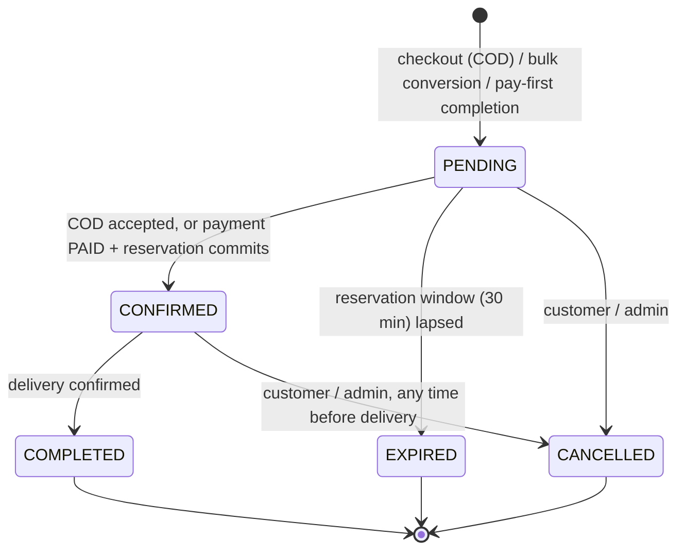

# Orders and Fulfilment

> **Status:** Verified (code + backend tests, including real-thread concurrency tests). **Last verified:** 2026-10-14. Mobile order screens and Admin order/delivery pages: **Unverified** (no frontend tests).
> **Source files:** [`services/order.py`](../../backend/app/services/order.py), [`order_state.py`](../../backend/app/services/order_state.py), [`fulfillment.py`](../../backend/app/services/fulfillment.py), [`fulfillment_state.py`](../../backend/app/services/fulfillment_state.py), [`inventory_reservation.py`](../../backend/app/services/inventory_reservation.py); routers `orders.py`, `fulfillments.py`; models `order`, `order_item`, `order_address`, `fulfillment`.
> **Tests:** [`test_phase_13_cart_orders.py`](../../backend/tests/test_phase_13_cart_orders.py), [`test_phase_15_inventory_reservation_fulfillment.py`](../../backend/tests/test_phase_15_inventory_reservation_fulfillment.py), [`test_phase_16_fulfillment_delivery.py`](../../backend/tests/test_phase_16_fulfillment_delivery.py), [`test_phase_18_cancellation_refunds.py`](../../backend/tests/test_phase_18_cancellation_refunds.py), [`test_cross_customer_access.py`](../../backend/tests/test_cross_customer_access.py).

## Order state machine

`order_state.transition_order_status` is authoritative for **cancellation** only; other order-status writes (`CONFIRMED`, `EXPIRED`, `COMPLETED`) are guarded by narrow precondition checks at their call sites (documented in the module docstring). DB `CHECK` limits `status` to the five values. Same-state transitions are idempotent no-ops; anything else raises → 409.

Pay-first online orders are created already `PENDING` and become `CONFIRMED` within the same completion flow ([DATA_FLOW](../02-architecture/DATA_FLOW.md) §3).

## Order data

| Table | Content |
|---|---|
| `orders` | `order_number` (`ORD` + date + 8 hex; unique), `user_id`, `cart_id` (unique, nullable for bulk), `status`, `subtotal_amount`, `discount_amount`, `delivery_fee`, `total_amount` (all ≥ 0, `discount ≤ subtotal`), `currency`, `promotion_id`/`applied_promo_code`, `placed_at`, cancellation fields (`cancelled_at`, `cancelled_by_user_id`, `cancellation_reason` ≤ 500) |
| `order_items` | Snapshot: product name, variant name, SKU, unit, quantity, unit price, total |
| `order_addresses` | Snapshot of the delivery address (lines, city, state, postal code, GPS) |
| `fulfillments` | One per order, created when the reservation is committed; `status`, `delivery_partner_user_id`, `assigned_at`, `delivered_at`, `inventory_location_id` |

Historical totals are never recalculated; promotion reversal on cancel leaves the order's own amounts untouched.

## Customer operations (role `CUSTOMER`, own orders only; 404 otherwise)

`GET /orders`, `GET /orders/{id}`, `POST /orders/{id}/cancel`, `GET /orders/{id}/payment`, `/refund`, `/fulfillment` (customer view), `/reservation`. Orders are listed newest first with page/page_size.

## Staff operations

| Operation | Gate | Notes |
|---|---|---|
| `GET /orders/admin` (list/search/filter) | perm `orders.read` (ADMIN, OPERATIONS, HUB_STAFF) | Filters: `status`, `payment_status`, `fulfillment_status`, `date_from/to`, `q` (order number, customer name, email **or phone**, `ILIKE`; `%`/`_` not escaped) |
| `GET /orders/admin/{id}` | perm `orders.read` | Returns customer name, email and **full phone number** plus payment, fulfilment and refund |
| `POST /orders/admin/{id}/cancel` | role ADMIN | Audited (`order.cancel`) |
| Fulfilment: `GET /fulfillments[/{id}]`, `/order` | warehouse roles + delivery partner (partners see only their own) | – |
| `POST /fulfillments/{id}/status` | ADMIN/HUB_STAFF/OPERATIONS | Advances **exactly one** warehouse step (`PENDING→PICKING→PACKED→READY_FOR_DELIVERY`) |
| `POST /fulfillments/{id}/assign` | ADMIN/HUB_STAFF/OPERATIONS | `READY_FOR_DELIVERY → ASSIGNED`; requires a delivery partner (must hold `DELIVERY_PARTNER`) |
| `POST /fulfillments/{id}/out-for-delivery`, `/deliver` | ADMIN or the assigned `DELIVERY_PARTNER` | `ASSIGNED → OUT_FOR_DELIVERY → DELIVERED` |

**Privacy finding (PRIV-1):** order detail returns the *unmasked* customer phone to every holder of `orders.read` (including HUB_STAFF and OPERATIONS), and the order list can be searched by phone, while the Customers module masks phones for everyone without `customers.view_sensitive`. The masking is therefore not a barrier for those two roles ([PRIVACY](../08-security/PRIVACY.md)).

## Cancellation (one atomic transaction)

Lock order → check legality (`PENDING|CONFIRMED`; already `CANCELLED` = idempotent) → set cancellation fields → flush → release reservation (`ACTIVE|COMMITTED → RELEASED`) → reverse the promotion redemption → create a refund request iff the payment is an online payment that reached `PAID` (see [REFUNDS](REFUNDS.md)) → audit (admin only) → commit → notify. A cancellation racing a delivery confirmation resolves to exactly one winner because both lock the **order first**. Physical stock is never restored (it was never consumed); only the reservation is released.

## Delivery confirmation (atomic)

See [DATA_FLOW](../02-architecture/DATA_FLOW.md) §5. The only moment physical stock is consumed, the order becomes `COMPLETED`, and COD cash is recorded as collected. Rejected if the order is no longer `CONFIRMED` (cancelled orders cannot be delivered, `_assert_order_still_active`).

## Concurrency and idempotency

Order → Payment → refund/fulfilment lock ordering is uniform; duplicate cancels, duplicate `deliver` calls and duplicate status changes are no-ops; `confirm_delivery` is idempotent when already `DELIVERED`. Covered by the real-thread tests listed above.

## Failure scenarios

| Scenario | Result |
|---|---|
| Cancel after delivery | 409 "Cannot cancel an order in status COMPLETED" |
| Customer opens another customer's order | 404 |
| Assign a user without the `DELIVERY_PARTNER` role, an inactive user, or a non-existent user | 409 "does not hold the DELIVERY_PARTNER role" / 409 "account is not active" / 404 |
| Delivery lot cannot cover its allocation | whole transaction aborts |
| App crash between checkout and COD confirmation | order stays `PENDING` until it expires |

## Known gaps

- No per-step timestamps for confirmed/picking/packed (only `assigned_at`, `delivered_at`, `placed_at`, `cancelled_at`), so the mobile tracker shows real times only for placed/delivered.
- No failed-delivery, return, substitution or partial-fulfilment flow.
- Fulfilment moves are staff-driven; there is no automatic progression.
- PAY-001 can attach an online payment to an already-existing order ([DEFECT_LOG](../testing/DEFECT_LOG.md)).
