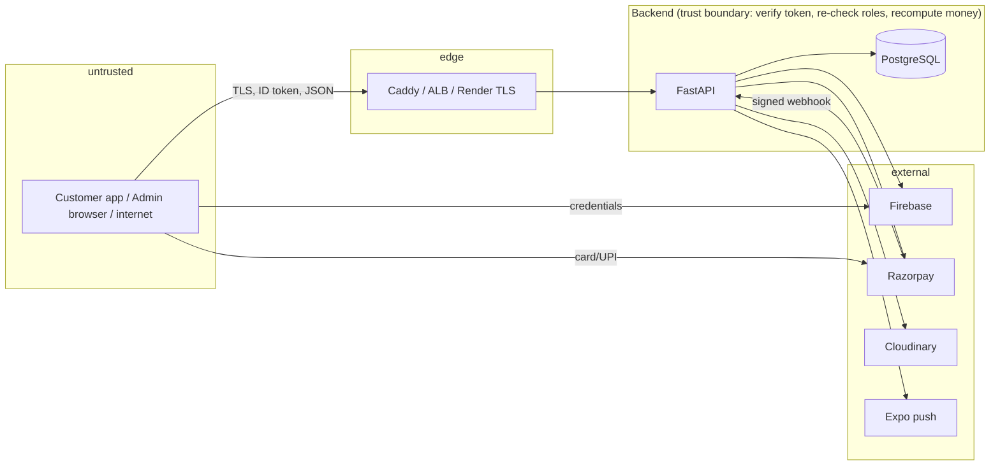

# Threat Model

> **Status:** Partially verified — an analysis grounded in the implemented design and the test evidence, **not** a formal assessment, and not exercised by an attacker. **Last verified:** 2026-10-14. Controls and findings: [SECURITY](SECURITY.md); evidence of what was tested: [`docs/testing/RISK_REGISTER.md`](../testing/RISK_REGISTER.md), [DEFECT_LOG](../testing/DEFECT_LOG.md).

## 1. Assets (what is worth attacking)

| Asset | Where | Why it matters |
|---|---|---|
| Customers' money and payment state | Razorpay, `payments`, `refunds`, `checkout_sessions` | Direct financial loss; refund fraud |
| Stock integrity | `inventory_lots`, reservations | Overselling, free goods, spoilage hidden |
| Customer personal data (name, email, phone, addresses with GPS, order history) | `users`, `addresses`, `orders`, `order_addresses`, `customer_notes` | Privacy and safety (home addresses) |
| Staff accounts and roles | Firebase + `user_roles` | Full control of prices, refunds, stock, customers |
| Server secrets | Render/VPS/K8s env, service-account key, Razorpay secrets, DB credential | Total compromise |
| Availability of sign-in and checkout | Backend + Firebase + DB | Revenue; observed to fail platform-wide on 2026-10-14 due to a configuration value |
| Brand/content integrity | home slides, ads, offers, product data | Defacement, misleading promotions |

## 2. Actors

Anonymous internet user · signed-in customer · malicious customer · curious or malicious staff member (HUB_STAFF/OPERATIONS/SUPPORT/DELIVERY_PARTNER) · compromised staff account · compromised developer machine or CI · third-party service failure/compromise (Firebase, Razorpay, Cloudinary, Expo, routing APIs) · network attacker.

## 3. Trust boundaries

Rules that define the boundary: the client is never trusted for identity (token only), role (database), amount (server), status (state machine) or object ownership (query filter). The webhook endpoint is public and trusted only after signature verification.

## 4. Threat scenarios

| # | Threat | Mitigation in place | Residual risk / status |
|---|---|---|---|
| T1 | Forge or replay a payment-success webhook | HMAC check, dedup row, amount/currency match, Razorpay re-query for client confirmations | Not reproduced in tests (Verified with fake gateway); live Razorpay unverified |
| T2 | Pay less than the order total / tamper with price, fee or discount | All amounts computed server-side from the cart; checkout session amount re-validated against Razorpay and the recomputed total | Mitigated; PAY-001 attaches a *valid* payment to the wrong order (open) |
| T3 | Double spend / duplicate order / oversell under concurrency | Row locks with fixed order, unique constraints, idempotent endpoints | Extensively tested with real threads; cross-process payment webhook not run |
| T4 | Read or change another customer's data (IDOR) | `user_id` filters; 404 for foreign objects; dedicated tests | Verified for tested resources; new endpoints need the golden-matrix update |
| T5 | Privilege escalation to staff | Roles from DB; permission map; self-registration can only create `CUSTOMER`; `WHOLESALER` unused | Verified; role grants are ADMIN-only. Admin UI mirror can drift but grants nothing |
| T6 | Steal or abuse staff sessions (token theft, no revocation) | Firebase ID tokens ≤ 1 h; revocation check when the service account exists | **REV-1:** no revocation check without the service account; ID token also sent in WS query string (SEC-005) |
| T7 | Brute-force or enumerate accounts | Firebase rate-limits sign-ins; app throttles OTP; `legacy-migrate` limited to 5/min/IP | SEC-002 (XFF), OPS-001 (per replica), SEC-003 (suspected oracle) |
| T8 | Abuse `/auth/sync` to create junk accounts | 20/min/IP; account needs a valid Firebase token (Firebase controls sign-up) | Low |
| T9 | Malicious or oversized upload | Staff-only endpoints; ≤ 8 MB; declared-type allow-list; stored on Cloudinary | UPL-1 (type trusted from header); staff accounts are the only uploaders |
| T10 | XSS / injection | ORM parameterisation; JSON API with restrictive CSP; React escaping; no `innerHTML` | Admin/website have no CSP; frontends untested |
| T11 | Leak secrets | `.env*` ignored; secrets only in host env | **SECR-1** key committed in `.mcp.json`; plaintext DB credential in a local `.env`; no secret scanning |
| T12 | Supply-chain compromise (dependency, base image, CI) | Lockfiles for JS; fixed Node/Python major versions | No Python lockfile, no scanning, floating image tags, CI deploys on push with no checks |
| T13 | Destroy data by mistake (test suite, scripts, migration) | DB-safety policy for tests; migrations transactional; compose gate | Seed scripts and multiproc harness can drop data if pointed at the wrong DB (guarded only for `*_test`); no restore drill |
| T14 | Denial of service / overload | Gzip, health probes, Caddy body cap | **PERF-001:** pool starvation → 100 % timeouts and ~6 min recovery at ~100 concurrent users; HPA scales on CPU which does not move; no WAF/CDN; Render cold start ≈ 44 s |
| T15 | Insider data scraping (staff) | Role-limited endpoints; SUPPORT is read-only with masked phone | **PRIV-1:** order detail exposes phone/email to `orders.read`; no bulk-export endpoint exists, but reads of personal data are not access-logged |
| T16 | Silent configuration failure (e.g. bad secret → all sign-ins 503; missing env → dev defaults) | Production start-up validation (partial) | Observed on 2026-10-14; CFG-1 |
| T17 | Third-party outage (Firebase, Razorpay, routing, Expo) | Documented fallbacks: routing → quote/checkout fail closed (503), no guess; payments → COD; push best-effort | Firebase/Razorpay outage blocks sign-in/online payment by design; no status monitoring |
| T18 | Refund fraud / mistaken refund | Admin approval, one refund per order, process guard, audit | Refund stuck in `PROCESSING` after a lost response has no in-app resolution (G-REF-1); audit rows not viewable |

## 5. Assumptions

Razorpay and Firebase behave as documented; the proxy in front of the backend overwrites `X-Forwarded-For` (true for Caddy; **not verified** for ALB/Render); the single-process deployment assumption holds; staff are not expected to be adversarial beyond the roles' permissions.

## 6. Recommended next analysis (not done)

Authenticated dynamic testing against a staging copy; Firebase App Check; review of Cloudinary upload presets and delivery URLs; review of the Render/EKS/VPS network exposure; threat modelling of the order-first payment path under a live Razorpay sandbox.
